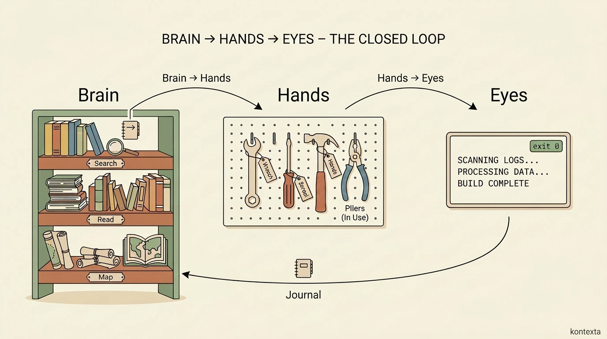
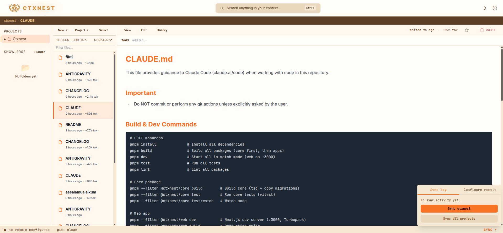

<h1 align="center">
  <br>
  Kontexta
</h1>
<p align="center"><i>(pronounced <b>kon-TEX-tah</b>)</i></p>
<p align="center"><b>One memory. One toolbox. One feedback loop. Any agent.</b></p>

<p align="center">
  <a href="https://glama.ai/mcp/servers/safiyu/kontexta"></a>
  <a href="https://smithery.ai/servers/safiyu/kontexta"></a>
</p>

Kontexta is a local-first **Model Context Protocol (MCP)** server that gives your AI coding agents — **Claude Code**, **Cursor**, **Cline**, **GitHub Copilot**, **Gemini**, **Antigravity** — a persistent memory and a controlled command surface. [Learn more at kontexta.dev](https://kontexta.dev)

Instead of agents losing context between sessions or inventing their own shell commands, Kontexta provides:
- **Brain**: A git-backed markdown vault with FTS5 search and surgical section edits.
- **Hands**: A sandboxed command engine defined by you in `kontexta.json`.
- **Eyes**: A feedback loop that journals results back into the brain.

## The Unique Value

Most AI tools trap context inside their own chat window. Kontexta moves that context to your own SSD, providing six core advantages:

### 1. Cross-Agent Handoff
- **Switch agents mid-project**: Claude Code journals a decision; Cursor reads it 5 minutes later.
- **Unified command surface**: Author your `kontexta.json` once; every agent uses the same validated tools and approval gates.
- **Multi-agent collaboration**: Different agents working on different tasks contribute to the same indexed knowledge base.
- **Zero-touch onboarding**: `projects_register` + `admin_onboard_agent` injects a fenced, version-stamped workflow rules block into `CLAUDE.md` / `AGENTS.md` / `GEMINI.md` / `.cursor/rules` / `.continue/rules` / `.clinerules` / `.github/copilot-instructions.md` so every new conversation — on any agent — wakes up already knowing how to use kontexta.

### 2. Cross-Project Awareness
- **Global reach**: An agent working in Project A can instantly search and read the documentation, context, and states of Project B.
- **Shared standards**: Solve a problem once, document it, and let your agent apply that solution across all your other projects automatically.
- **Heads-up on sensitivity**: Because the vault is global, every registered project is readable by any agent session you start. If you mix client work with personal projects, keep sensitive material in a separate vault (`KONTEXTA_DATA_DIR`) rather than registering it alongside everything else.

### 3. Deterministic Context Retrieval
- **SQLite FTS5 Power**: Instead of unpredictable vector-based RAG, Kontexta uses high-performance full-text indexing for deterministic, local-first context discovery.
- **Reliable Discovery**: Fast, exact keyword and regex-based search ensures you find what you're looking for without the "hallucination" risk of third-party embedding providers.

### 4. Token-Optimized Context Economy
- **Surgical fetching**: Instead of indiscriminately dumping whole directories into the LLM's context window, Kontexta provides tools to fetch specific file outlines, sections, or targeted search excerpts.
- **Budget awareness**: Every tool response includes `est_tokens` so agents can smartly budget what they pull into memory.

### 5. Separation of Code and Context
- **The "Context.md" Killer**: Stop littering your source tree with `CONTEXT.md` or `AI_NOTES.md` files that clutter your PRs and get stale.
- **Global Knowledge Vault**: Keep your main codebase pristine. Architectural decisions, agent journals, and cross-project standards live in a separate, dedicated global vault accessible by any agent instance.

### 6. Compounding Intelligence
- **Continuous learning**: Through the "Eyes" and journaling system, your AI agents document their decisions, successes, and mistakes.
- **Smarter next time**: A problem solved today is saved in the Brain, meaning tomorrow's session starts with the benefit of yesterday's experience.

---

## Architecture: Brain → Hands → Eyes

Kontexta builds a closed feedback loop that makes every turn smarter than the last.

<p align="center">
  
</p>

### 1. Brain — The Context Engine
A markdown knowledge vault optimized for context-window economy.
- **FTS5 Search**: Instant local keyword search.
- **Surgical Edits**: Tools for reading and updating specific markdown sections without pulling entire files.
- **Token-Aware**: Every response includes `est_tokens` and `size_bytes` so agents can budget their context.

### 2. Hands — The Command Engine
A project-defined command surface that replaces "unrestricted shell access" with a sandboxed contract.
- **Explicit boundaries**: You declare exactly what an agent can do via `kontexta.json`. There is no unrestricted shell access.
- **Sandboxed**: Locked working directory, clean environment, and ring-buffered output.
- **Human-in-the-loop**: High-risk commands can require a cryptographic one-time token, pausing execution until you explicitly approve it.

> [!IMPORTANT]
> The sandbox enforces *your* contract — it doesn't infer risk on its own. A command only requires approval if you mark it high-risk in `kontexta.json`; anything else runs unattended within the sandbox. Treat `kontexta.json` like a permissions file: the security posture is exactly as careful as your authorship of it.

### 3. Eyes — The Feedback Engine
Closes the loop by capturing Hands' output and journaling learnings back into the Brain.
- **Live Observation**: Tools like `admin_overview({mode: "whats_new"})` and `files_diff_against_disk` let agents see what actually changed.
- **Automatic journaling**: Every MCP tool call is captured to a per-project, append-only event log (Layer 1). The `journal_distill` tool — or the lenient-mode auto-fallback — collapses raw events into per-topic markdown summaries (Layer 2) indexed alongside the rest of the knowledge base. `journal_write` (`kind: "note"` / `"intent"`) lets agents enrich the log with decisions and topic pivots. Phase 2 also adds `journal_housekeep` (retention/archival), `journal_commit_upgrades` (closes the subagent dispatch loop), strict mode (configurable per project — blocks read tools when backlog exists), and an opt-in WebUI scheduler that runs mechanical distillation on a 15-minute clock when the dashboard is installed. **[Learn more about Journaling modes and configuration in docs/JOURNAL.md](docs/JOURNAL.md).**

---

## How it Works in Practice

Imagine you are switching from **Claude Code** to **Cursor** mid-way through a feature.

### The Problem: The "Context Gap"
- **Claude Code** knows why you chose that specific library.
- **Cursor** doesn't. You have to copy-paste or re-explain everything.
- **CONTEXT.md** files help, but they get stale, they clutter your PRs, and they don't capture live decisions.

### The Kontexta Solution
1. **Journaling**: As Claude Code works, kontexta automatically captures every tool invocation and decision to a structured event log.
2. **Persistence**: Those logs are saved in your local Kontexta brain, not the chat window. The `journal_distill` tool consolidates raw events into per-topic markdown entries that are searchable alongside your knowledge base.
3. **Seamless Handoff**: When you open Cursor, it immediately sees the recent journal entries and architectural state via the Kontexta MCP. 
4. **Zero Re-explanation**: Cursor "wakes up" with the exact same context Claude had.

---

## How Kontexta Compares

Kontexta doesn't try to replace your favorite agent or memory library — it sits in a different spot. Here's an honest read of where it overlaps and where it doesn't:

| Capability | `CLAUDE.md` / `AGENTS.md` | Vendor memory (Cursor rules, Claude Projects) | mem0 | Zep | **Kontexta** |
| :--- | :--- | :--- | :--- | :--- | :--- |
| **Setup cost** | None — just a file | None — built in | SDK integration in your app | SDK + service | MCP server + `kontexta.json` |
| **Cross-agent portability** | Per-agent flavored files drift apart | Locked to one vendor | App-level, not agent-level | App-level, not agent-level | Same MCP surface for Claude Code, Cursor, Cline, GitHub Copilot, Gemini, Antigravity |
| **Retrieval model** | Whole file dumped into context | Whole file / vendor-managed | Vector + graph (semantic) | Temporal knowledge graph (semantic) | Deterministic FTS5 + regex; surgical section reads |
| **Token accounting** | None | None | None exposed to agent | None exposed to agent | Every response carries `est_tokens` / `size_bytes` |
| **Command execution** | N/A | Vendor-defined tools | N/A (memory only) | N/A (memory only) | Sandboxed `Hands` with per-command contracts and approval tokens |
| **Storage** | Repo file (clutters PRs) | Vendor cloud | Self-host or hosted, vector DB | Self-host or hosted | Local SQLite + markdown vault, with an optional relay for backup and multi-machine sync |
| **Best at** | Static project conventions | Zero-config personal memory | Semantic recall inside one app | Long-running conversational memory | Multi-agent handoff + governed local execution |

**Honest tradeoffs:**
- If you only use one agent and one project, `CLAUDE.md` or vendor memory is simpler — reach for Kontexta when you're switching agents or coordinating across projects.
- mem0 and Zep do semantic recall that FTS5 doesn't; Kontexta trades fuzzy matching for determinism and local-only operation.
- Kontexta's `Hands` sandbox has no equivalent in the memory tools above — that's the unique surface, not the memory itself.

---

## Quick Start (One Command)

Requires Node 22.x LTS. That's it — no Docker, no pnpm, no build.

```bash
npx kontexta start
```

Boots the dashboard on `http://localhost:23002` (opens in your browser) and starts the MCP server. First run walks you through master password, data location, and project registration in the browser.

Enable the coding agents you use in the dashboard and kontexta installs lightweight hooks so the journal also captures your conversation and shell commands — see [`docs/HOOKS.md`](docs/HOOKS.md).

### Add to your AI client (MCP-only)

If you only want the MCP server (no dashboard), point your AI client at:

```json
{
  "mcpServers": {
    "kxta": {
      "command": "npx",
      "args": ["-y", "kontexta", "mcp"]
    }
  }
}
```

Or install automatically via [Smithery](https://smithery.ai/servers/safiyu/kontexta):

```bash
npx -y @smithery/cli install safiyu/kontexta --client claude
```

### No MCP? Use the skill

If your AI client can't load MCP servers (e.g. managed installs that block user-added servers), the [`skills/kontexta`](skills/kontexta) agent skill exposes every kxta tool through a small Python bridge the agent runs from its shell. See [`skills/kontexta/README.md`](skills/kontexta/README.md).

### Alternative: Docker

For containerized deployments, see [`docs/INSTALL.md#docker-hub-compose`](docs/INSTALL.md#docker-hub-compose).

---

## Your Brain on More Than One Machine (Optional)

Everything Kontexta knows about you and your work (knowledge files, projects, profile, journals, calendar, tags) is your **brain**. It lives on your machine as markdown files and SQLite, and works fully offline. If you use Kontexta on more than one machine, or want a copy that survives a lost laptop, connect your brain to a **remote**.

A relay hosts any number of brains, each fully separate. For your brain it is two things at once: the durable copy of everything (nothing is ever pruned, a brain remembers) and the sync engine between your machines. Teammates can use the same relay, each with their own brain; nobody sees anyone else's.

**The remote cannot read your brain.** Payloads (file contents, paths, tags, journal entries, calendar data) are encrypted on your machine with AES-256-GCM before they leave it. The key is derived from your share id and never sent anywhere; the relay only ever sees a derived routing id, plus the metadata it needs to order ops (record ids, op kinds, which machine, timing and size). If a relay is compromised or misconfigured, an attacker gets ciphertext. The flip side: lose every copy of the share id and the data is unrecoverable, and revoking a machine stops its access to the relay but not its ability to decrypt data it already holds (for that, create a new brain).

Machines exchange fine-grained operations (file create, update, delete, move, tags, favorites, projects, calendar, journal) over short polling, so a decision made on one machine appears on the others without merging repositories or database files. A machine that never connects simply works locally.

### Run a relay

The relay is `kontexta-relay`: a plain, stateless short-polling HTTP service with one SQLite file and one port (`23010`). Run it with Node or Docker.

```bash
# With Node (any box, VPS or Cloud Run):
KXTA_RELAY_PEPPER="$(openssl rand -hex 32)" \
KXTA_RELAY_ENROLL_SECRET="$(openssl rand -hex 16)" \
  npx kontexta-relay

# With Docker (published image, no clone needed):
docker run -d --name kontexta-relay -p 127.0.0.1:23010:23010 -v kontexta-relay-data:/data \
  -e KXTA_RELAY_PEPPER="$(openssl rand -hex 32)" -e KXTA_RELAY_ENROLL_SECRET="$(openssl rand -hex 16)" \
  ghcr.io/safiyu/kontexta-relay:latest

# Or with compose, from the repo root (pulls the image, or builds it with --build):
docker compose -f docker-compose.relay.yml up -d
```

It is ready once `http://127.0.0.1:23010/health` answers.

| Variable | Default | Purpose |
| :--- | :--- | :--- |
| `PORT` / `HOSTNAME` | `23010` / `0.0.0.0` | Where it listens. |
| `HOST_PORT` / `HOST_BIND` | `23010` / `127.0.0.1` | Docker compose only: the published port and interface. |
| `KXTA_RELAY_PEPPER` | *(empty)* | HMAC pepper bound into token and share id hashes. Required for any non-loopback deployment. |
| `KXTA_RELAY_ENROLL_SECRET` | *(empty)* | Secret needed to **create** a brain. Joining an existing brain needs only its share id. |
| `KXTA_RELAY_DB` | `~/.kontexta-relay/relay.db` | Path to the SQLite file (the Docker image keeps it at `/data/kontexta-relay.db` on its volume). |
| `KXTA_RELAY_ALLOW_OPEN_CREATE` | *(unset)* | `1` lets anyone create brains (local experiments only). |
| `KXTA_RELAY_ALLOW_DEFAULT_PEPPER` | *(unset)* | `1` allows the public default pepper on a non-loopback host (not recommended). |

> [!IMPORTANT]
> Set both `KXTA_RELAY_PEPPER` and `KXTA_RELAY_ENROLL_SECRET` for anything beyond local experiments. The server refuses to start on the default pepper when bound beyond loopback, and without the enrollment secret nobody can create a brain. Put TLS in front of it (nginx, Caddy, Cloudflare Tunnel, Cloud Run) as you would for any endpoint that issues credentials.

All brains, their full history and their machines live in one SQLite file (the Docker volume `kontexta-relay-data`). Back that file up; to wipe everything, `docker compose -f docker-compose.relay.yml down -v`.

### Connect a machine (`kontexta brain`)

The share id is what identifies a brain, and it is also the secret for joining it and the root of its encryption key. Kontexta generates it when you create a brain; you paste it on your other machines.

```bash
# First machine: create a brain (prints the share id once, save it):
kontexta brain connect https://brain.example.com --create --name "My brain" \
  --enroll-secret "$KXTA_RELAY_ENROLL_SECRET"

# Another machine (or a replacement for a lost one): join with the share id:
kontexta brain connect https://brain.example.com --share-id ABCD-EFGH-...

# Brain name, relay, machines, outbox depth, skipped ops, cursor:
kontexta brain status

# List the machines in your brain, or revoke one:
kontexta brain machines
kontexta brain machines remove <machine-id>

# Show the full share id again (asks first):
kontexta brain share

# Sync on demand, or run the loop in the foreground on a machine without the web app:
kontexta brain push
kontexta brain pull
kontexta brain run

# Stop syncing (everything stays on this machine):
kontexta brain disconnect
```

The same flow is on the **Brain** page of the web app. Add `--json` to any subcommand for machine-readable output. `--no-keep-share-id` keeps the share id off this machine, and `--data-dir` / `--timeout` target a specific vault or bound a request. The Kontexta web app and the MCP server start the sync loop for you once a machine is connected.

**Joining.** Creating a brain on an empty relay makes your current vault its first content. Joining an existing brain on a new machine pulls the brain's current state instead of replaying its history. A machine that already has content keeps files that match, and where a file differs from the brain's version both are kept and a conflict copy appears for you to resolve.

**How the cadence works.** A connected machine short-polls: **15 s** while active, **60 s** while idle, and **exponential backoff up to 5 minutes** on failure.

**Ordering and conflicts.** The relay assigns every op a sequence number, the only source of ordering (client clocks are never trusted). Each machine tracks the version of each record it has seen and sends it with every edit, so an edit made on top of everything the machine has pulled is accepted. When two machines edit the same record without having seen each other's change, the relay keeps both. Neither machine overwrites its own file: each gets a conflict copy next to the canonical file (`<name> (from <machine label>).<ext>`) and lists it in the Conflict Manager, where you choose keep server, keep mine, keep both, or a merged version. Every resolution is pushed so your machines converge. Two machines creating the same path independently produce a path conflict instead of swapping content.

**Journals merge instead of conflicting.** The daily journal (`knowledge/journal/journal-YYYY-MM-DD.md`) is append-only, so when two machines write the same day their entries are merged into one sorted union on every machine. No conflict copy, nothing lost, and every machine ends with identical content.

**Portable ops.** Ops never carry machine-local ids or absolute paths. Records are referenced by global id (`<id>@<machine>`), and file paths travel relative to the data directory. A remote op that points outside the data directory is refused, and files in project repos never sync (only your knowledge base does).

**Skipped ops.** An op that cannot be applied on a machine (an unsafe path, a record that machine does not have) is recorded in the local `sync_skipped_ops` table and skipped so it cannot block the rest of the log. Other apply errors are retried a few polls first. A malformed op still stops the pull, so a version mismatch between machine and relay is noticed rather than hidden.

---

## Security & Network Exposure

Kontexta's dashboard is designed for **local-first use** — running on `localhost` or on a trusted machine you control. The threat model is:

- **Default safe:** A master password protects the UI. Sessions are HMAC-signed cookies, passwords are scrypt-hashed.
- **IP bypass is opt-in per IP.** During setup you can allowlist IPs (e.g. `127.0.0.1`) to skip the login prompt from trusted addresses.
- **Reverse-proxy mode is opt-in.** If you put Kontexta behind nginx, Caddy, or Cloudflare Tunnel, enable **"Trust `X-Forwarded-For` headers"** during setup. Without this flag, those headers are ignored — so a LAN attacker cannot spoof an allowlisted IP.
- **`kontexta.json` is your responsibility.** The Hands engine executes shell commands you declare in this file. The sandbox limits *where* and *how* those commands run (path traversal blocked, ReDoS-proof regex, locked CWD, stripped PATH), but the *what* is whatever you wrote. Review any `kontexta.json` you didn't author yourself — same caution you'd apply to a Makefile, GitHub Actions workflow, or shell snippet from the internet.

> [!WARNING]
> Do not expose the dashboard to the public internet without a trusted reverse proxy in front. The auth layer is sufficient for localhost and LAN use; it is not hardened against direct internet exposure (no rate limiting, no brute-force lockout, no MFA).

---

## Demo & Walkthrough

<p align="center">
  <a href="https://youtu.be/kghe72WjahY">
    
  </a>
</p>

**In this demo:**
- System audit and web clipping.
- Local RAG and context gathering.
- The Brain/Hands/Eyes loop in action.

**No-install demo:** Try the MCP endpoints interactively right from your browser on the [Glama Kontexta page](https://glama.ai/mcp/servers/safiyu/kontexta).

---

## Project Status & Transparency

**Why the high version number on a fresh repository?**
If you look at the commit history, you might wonder how a repository with so few commits reached its current major version. 

Kontexta wasn't built over a weekend. It began over a year ago as a private, monolithic toolchain used to manage complex, multi-agent coding workflows. The versioning reflects its true architectural maturity. 

Recently, I undertook a major effort to industrialize and modularize this engine, restructuring it into the three core pillars you see today: **Brain**, **Hands**, and **Eyes**. This process involved decoupling the core from private infrastructure and moving to a clean, open-source monorepo. The condensed git history is the result of this clean extraction—leaving behind internal legacy commits to publish only the battle-tested, production-ready framework available today.

---

## Roadmap

What's deliberately deferred and what triggers will pull it forward lives in [`docs/ROADMAP.md`](docs/ROADMAP.md). Notable open items: per-call project resolution in journaling, server-side LLM upgrade for the WebUI scheduler, and Layer 3 (embeddings + graph + semantic clustering).

---

## Features Breakdown

### Brain
- Global vault: local-first knowledge store with git-backed history and version rollbacks.
- 58 MCP tools tuned for context economy.
- Batch operations (up to 500 files/call), grep, and regex support.
- Web clipping with auth-wall detection.
- Full git-backed versioning: `files_get_history`, `files_get_diff`, `files_restore`.
- **Agent context rules onboarding:** `projects_register` detects existing `CLAUDE.md` / `AGENTS.md` / `GEMINI.md` / `.cursor/rules/*.mdc` / `.continue/rules/*.md` / `.clinerules` / `.github/copilot-instructions.md` and recommends a follow-up. The `admin_onboard_agent` tool injects an idempotent, version-fenced workflow rules block (or scaffolds one for the right agent) so every new conversation starts already aware of kontexta's conventions.

### Hands
- Project-specific `kontexta.json` tools map.
- Strict sandbox: realpath-verified CWD, stripped `PATH`, and hard timeouts.
- ReDoS-proof parameter validation via `re2`.
- CSPRNG-bound confirmation tokens for high-risk commands.

### Dashboard
- Built-in `/docs` page with a searchable catalogue of all 66 core tools.
- Form-based `kontexta.json` editor with live validation.
- Real-time status bar streaming git activity over WebSockets.

### Calendar
- Generic, dependency-aware calendar for tracking events across anything you name — a server, a delivery van, a store location, a piece of equipment, a room, or anything else you schedule against.
- Automatic conflict detection: overlapping windows on the same entity, overlapping windows on linked entities, and events scheduled too close together (configurable buffer).
- Month, week, and agenda views in the dashboard, matching the rest of the UI; click to add or edit events, manage entities and their dependency links.
- Export any date range as a standard `.ics` file for Outlook, Google Calendar, or Apple Calendar.
- 11 MCP tools so agents can schedule, link, and check conflicts straight from chat.

### Publish
- **CLI-driven documentation generation.** Turn your knowledge base into polished documentation sites, API references, and LLM-readable docs.
- **Render blocks.** Composable output blocks for endpoints, glossary, mermaid diagrams, navigation, LLMs, markdown, and more.
- **Seed templates.** Pre-built templates for common documentation patterns — get started in minutes.
- **Pipeline architecture.** Pluggable pipeline with configurable sources, renderers, and output targets.

---

> [!TIP]
> Deleting a project file in Kontexta only un-indexes it from the AI's memory. Your physical source code is never touched.

---

## Contributing

Kontexta is a project for developers, by developers. If you'd like to contribute new tools, improve the core engine, or refine the dashboard, please see our [CONTRIBUTING.md](CONTRIBUTING.md) for architecture guidelines and local setup instructions.

Built with care for the future of agentic coding.
License: Apache-2.0
